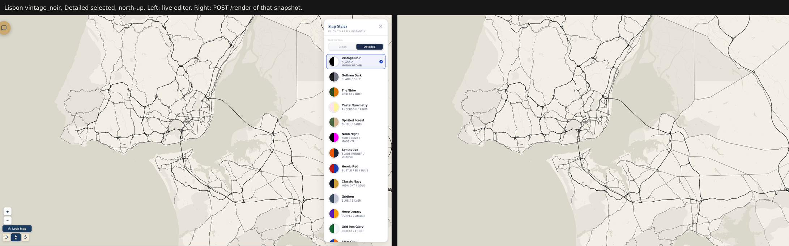
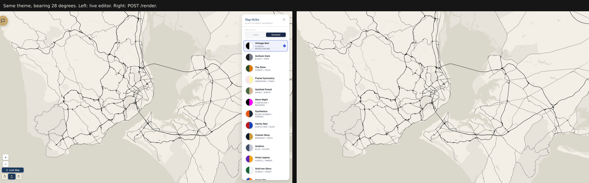
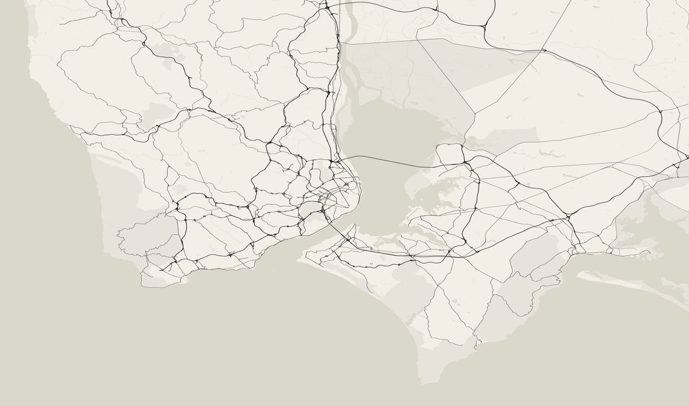
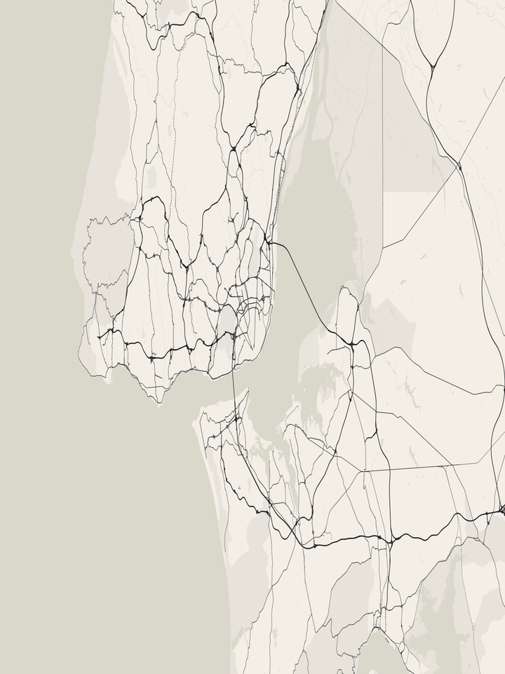
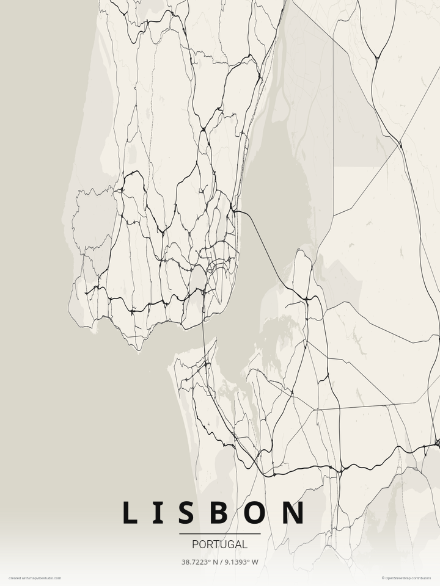

# Render parity

What the customer sees in MapVibe Studio (`insforca/mapvibe-studio`, MapLibre GL JS in the browser) and what this service prints are two interpretations of a copied style. They can agree on a given order and still be the wrong picture, because both sides can be drawing a style the Detailed button never actually painted. This note maps every place they can diverge, shows Lisbon frames from the live editor next to `POST /render`, and recommends one source of truth.

No production behaviour changes in this pull request. Design B print standards stay as they are: one pass at 300 DPI or higher, 400 DPI when the sheet fits, longest edge 14,400 px, 150 megapixels, 8-bit RGB PNG with a `pHYs` chunk and the vendored sRGB2014 ICC profile (`assets/color/sRGB2014.icc`, 3,024 bytes).

## What was read first

| Repo | File | What it actually says |
|---|---|---|
| `mapvibe-render-service` `main` (`6328fba`) | `docs/HANDOFF.md`, `docs/DECISIONS.md` | Those files are not in this repository. |
| `mapvibe-studio` `main` | `docs/HANDOFF.md`, `docs/DECISIONS.md` | One entry each, dated 2026-11-10, about the WebMCP origin-trial header. Nothing about map rendering. |
| `mapvibe-studio` | `docs/PREVIEW-RENDER-PIPELINE.md` | Still describes the Python / OSMnx preview path. That renderer is retired. Clean and Detailed both go through MapLibre now. |

Production `/health` on 2026-11-19 reported `3.6.0@6328fba7851294033feacc9d3a5bf14e1a318941`, the same commit as this branch's base. `RENDER_API_SECRET` is set on the Railway service and on the studio Vercel project. It is a sensitive value, so neither the Railway connection nor the Vercel API returns it, and it was not in this machine's environment. A `POST /render` to production with no key returns 401. The images below are `POST /render` against a local process of that same commit, with the Dockerfile's software GL (`LIBGL_ALWAYS_SOFTWARE=1`, `@maplibre/maplibre-gl-native` 6.4.1). The local process used a throwaway key. Nothing called `/fulfill`, a vendor, or a Shopify order or cart route.

## How a picture becomes a print

1. The editor builds a MapLibre style with `generateMapStyle` (`maplibreStyle.ts`) and draws it with `maplibre-gl` `^5.19.0`. The map element is then CSS-scaled by `1/5.5`. Measured on the live editor: `transform: matrix(0.181818, 0, 0, 0.181818, 0, 0)`, container `8845×5226` CSS pixels, on screen `1608×950`.
2. Line widths in that style are already multiplied by `5.5^0.8` (`compensateLineWidthStops`).
3. At checkout, `useStoreConfig` stores `map.getStyle()`, center, zoom, bearing, pitch, axis-aligned bounds, poster centimetres, and the text fields. It does not store the map's CSS pixel size.
4. Fulfillment downloads that JSON and replays it through native MapLibre. `resolvePrintCamera` keeps the editor zoom and grows a framebuffer with `pixelRatio`, floored at 1. A smaller output is Lanczos-scaled with `fit: fill`. Fades and the Roboto lockup are painted afterwards with node-canvas.

`POST /render` is the same camera and the same native renderer. It does not rewrite tile URLs. Fulfillment does.

## Where they diverge

### Style JSON and versions

The editor and the print service do not share a package. `src/editor-detailed-style.ts` is a hand copy of `generateMapStyle`, used by tests and `scripts/parity-lisbon.mjs`. Fulfilment does not call it. A real order replays whatever `styleJson` was stored.

The copy has already drifted from the studio file:

- The live style sets waterway opacity by class (`river` 1, `canal` 0.9, `stream` 0.72, `ditch` 0.48). The copy uses one opacity.
- The live style sets `fill-antialias` and a water `fill-outline-color`. The copy omits them.
- The copy defaults residential roads and paths to off. The studio generator defaults them to on, and the poster store then turns them off. A test that treats the copy as "the editor" is testing a third style.

Engines differ too: browser `maplibre-gl` 5.19 versus native `maplibre-gl-native` 6.4.1. Line joins, antialiasing, and symbol placement are not the same code.

### Fonts

The poster lockup is Roboto on both sides when `fontFamily` is empty. The editor CSS is `Roboto` 700 / 300 / 400 (`mapvibe.css`). This service registers the bundled `Roboto-Bold.ttf`, `Roboto-Regular.ttf`, and `Roboto-Light.ttf`. Light is registered as the family `Roboto Light` because node-canvas collapses two files that share the name-table family `Roboto`.

The map itself has no symbol layers. `glyphs` is `/glyphs/{fontstack}/{range}.pbf` (Noto Sans on the studio origin) and nothing in the style uses it. There are no place names on the map in the editor or in the print. Contours are the same: no contour layer in either style. A mention of contours in `shopify/sections/main-index.liquid` is marketing copy.

A non-empty `fontFamily` is a different story. The design-receipt allowlist accepts Montserrat, Playfair Display, Oswald, Noto Sans JP, Source Sans Pro, Raleway, Lato, Merriweather, and Bebas Neue. The editor loads those from `@fontsource`. This service fetches one Google Fonts file and registers it under the family name. The receipt allowlist does not list the string `Roboto`; the default face is the empty string.

City size is also computed twice. The editor runs `useFitText` (binary search, cap `0.085` of the text box, floor 6 px, and it will tighten letter-spacing). The print uses `shrinkFont` in `poster-text.ts` from `6.94cqmin` / `2.55cqmin` / `1.62cqmin` and a width estimate. Those agree for a short name on a large sheet and disagree for a long city name.

### Road widths and zoom at print DPI

Widths are in editor pixels, evaluated at the stored zoom. The print does not multiply them again. That part is aligned: a line that is a given fraction of the internal map stays that fraction of the sheet when the output aspect matches the internal map and `pixelRatio` is `output / internal`.

Two things still move the strokes:

- The browser then scales the whole map by `1/5.5` with CSS. The print scales with a GL pixel ratio, or with a Lanczos `fit: fill` when the ratio would fall below 1. The kernels are different.
- `RENDER_DEVICE_SCALE` is ignored. An old deploy that expected it to thicken strokes will not get that.

At the Lisbon zoom used below (12.6), major roads are past the overview layers (`maxzoom` 11.8) and on the detail stops. That is the same in both pictures.

### Fades

`GradientFades` draws `.poster-fade--bottom` at 14% of the sheet, pinned to the bottom, with the ten stops in `preview.css`. `applyFades` copies that band and those stops for `fullbleed` and `default`. `none` draws nothing. `text` is a separate top-and-bottom wash.

The styles screen and the checkout map captured here do not show that fade. `MapCanvas` mounts the fade and the lockup only when `isPreviewMode` is true. The PREVIEW control on the live product opened an order card over the full-bleed map. The wrapper class stayed `mvs-canvas-wrap`, with no `--preview`. The customer looking at that screen sees the map edge to edge.

`POST /render` still builds an overlay whenever `showPosterText` is omitted, because the condition is `displayCity || displayCountry || showPosterText !== false`. An omitted flag is treated as on. The landscape renders that passed `showPosterText: false` have no fade. The portrait lockup, which asked for text, has the 14% wash. There is a second fade class, `.mvs-poster-fade`, 25% tall and sitting 12.5% above the bottom, used by the framed-poster markup. The print follows `GradientFades`, not that class.

### Rivers, buildings, colours

Water, waterway, park, aeroway, rail, and building layers are in the generated style and in the captured `styleJson`. Building fill is 0.84 opacity, min zoom 8.2 when the distance is 30 km or less. Colours for Vintage Noir come from the theme (`#F8F8F6` land, `#DDDDDB` water, roads from `#222222` down to `#AAAAAA`). The print replays those paint values. It does not re-read `assets/themes.json` for a styled order.

At city zoom the building footprints are small. The visible colour difference in these frames is the water polygon, which follows whichever tiles answered.

### Labels and the text lockup

No map labels, as above. The lockup is DOM in the editor and node-canvas in the print.

The print always draws `© OpenStreetMap contributors` in Roboto Light, and draws `created with mapvibestudio.com` when `includeCredits` is on (the default). The editor lockup has city, rule, country, and coordinates. It has no credit line. The desktop CSS the print was measured against (`padding: 6px 18px 14px`, city `line-height: 1.15`, tracking `0.45em`) matches the later override in `mapvibe.css`. Below 900 px the same stylesheet switches the city to `letter-spacing: 0.15em` and a `clamp()` font size. A phone preview and a print of the same snapshot use different type.

### Framing, bearing, aspect, crop

`useStoreConfig` stores `getBounds()`, which is the axis-aligned box around the rotated viewport. It does not store `mapWidth` / `mapHeight`. `resolvePrintCamera` can use those sizes, and the comment in `print-parity.ts` says they are what keeps a rotated frame honest. They are absent on current snapshots, so the service derives a viewport from the bounds.

Measured on the Lisbon bearing-28 frame:

| Input | Logical viewport the renderer built |
|---|---|
| Editor container | `8845 × 5226` |
| Snapshot bounds, no container size | `10263 × 8767` (`source: editor-viewport`) |

That second viewport is the bounding box of the rotated view, then `fit: fill` into the output rectangle. North-up, the derived box matched the container (`8845 × 5226`). Putting that landscape view into a 3:4 poster (`720 × 960`) stretches it. The portrait image below is that stretch, with no text. The lockup image is the same geometry plus the type and the credits.

Canvas wrap (`print-window.ts`) is a separate expansion: when the product is a canvas and `dimensionsArePrintArea` is absent, the service grows the bounds so the wrap is extra map. The editor can set the flag when the snapshot is already the print sheet. A missing flag expands once. A flag that is present and wrong expands twice or not at all.

`usePrintFrameZoom` is supposed to change zoom when the UI goes from the full-bleed map to the framed poster so the geographic width stays constant. The captured PREVIEW step did not change the wrapper into preview mode, so that zoom shift did not run. The map the order card was sitting on is the full browser rectangle, about `1.69:1`, while an 18×24 poster is `0.75:1`.

### Tile sources

On the Shopify embed (`?shopify=1`) the style source is `/api/tilejson`. That route proxies MapTiler Planet v3 when `MAPTILER_API_KEY` is set, and OpenFreeMap otherwise. The live response's tile host is `api.maptiler.com` and the name is MapTiler Planet v3. `mapvibestudio.com` is on the render allowlist, so an absolute `https://app.mapvibestudio.com/api/tilejson` is legal. Requesting it from this renderer returned HTTP 403.

Fulfillment does not try. Any source URL that is relative, contains `openfreemap.org`, or contains `mapvibestudio.com` is replaced with `https://tiles.openfreemap.org/planet`. Glyphs under the studio origin are replaced with MapTiler fonts when `MAPTILER_API_KEY` is set, otherwise OpenFreeMap fonts. The comparison renders below use OpenFreeMap, which is the print path. They are the editor style painted on a different tile set.

Direct `app.mapvibestudio.com` without `shopify=1` redirects to the product page. The editor the customer uses is the iframe, and that iframe asks for MapTiler.

### Clean and Detailed

Clean and Detailed are `roadDetailMode` `arteries` and `neighbourhood`.

`generateMapStyle` is memoised without `roadDetailMode` in the dependency list. The first render bakes `includeRoadSecondary` and `includeRoadMinorMid` from the initial mode, which is Clean, so those layers are created with `line-opacity: 0`. A later effect sets `visibility` on the mid and, in the captured style, the secondary and low layers. Visibility does not change an opacity of 0.

Captured on the live editor, Vintage Noir, after clicking Detailed:

| Layer | visibility | line-opacity |
|---|---|---|
| `road-minor-high` (trunk / primary) | default | zoom curve, 0.84 at zoom 6 |
| `road-secondary` | `visible` | `0` |
| `road-minor-mid` | `visible` | `0` |
| `road-minor-low` | `visible` | `0` |
| `road-path` | default | `0` |

A Washington DC pair, Clean then Detailed, same camera, was pixel-identical (mean absolute channel difference 0 on the 1608×950 screenshots). The Lisbon frame below was taken with Detailed selected. The street grid the button title promises ("Adds local streets") is not in the picture. The print replays the stored opacities, so it also omits them. `applyNeighbourhoodDetail` only runs for a staff `detailedRoads` override, and it deliberately does not raise minor-low or path opacity.

Parity on Detailed currently means both sides omit the neighbourhood.

## Evidence

Lisbon, Vintage Noir, camera set on the live map to `[-9.1393, 38.7223]`. The city search field kept the value `Washington DC` under synthetic keystrokes, so the camera was moved with the live `Map` instance. Zoom 12.6 north-up, and zoom 12.8 at bearing 28°. Theme control showed Vintage Noir selected. Detailed was the active segment.

`POST /render` body used that `styleJson`, center, zoom, bearing, and bounds. Comparison frames are 1100×650, the on-screen map's aspect (`1608×950`). They are reduced. They are not an 18×24 sheet. The PNG encoder still wrote density 400 and the sRGB2014 profile, because `/render` defaults `dpi` to 400 when the caller omits it. A real Design B 18×24 poster remains a single pass at 400 DPI inside the 14,400 px and 150 MP caps.

### North-up, Detailed selected

Editor: `evidence/lisbon-detailed-editor.png`. Render: `evidence/lisbon-detailed-render.png`.

The Tagus, the 25 de Abril bridge, and the arterial network are in both. The editor frame includes the styles panel, zoom controls, and the chat button. The render is the map alone. Roads are the Clean set: secondary, tertiary, residential, and paths are stored at opacity 0. Water comes from OpenFreeMap in the render and from MapTiler in the editor. At this zoom the coast and the major roads agree closely. That agreement will not hold for a tile update on only one service, or for a zoom where building footprints and minor classes matter.

### Bearing 28°

The right-hand image passed `mapWidth` and `mapHeight` (`8845×5226`), which a real snapshot does not. With those sizes the logical viewport matches the editor container.

The image a stored snapshot actually produces, bounds only, built a `10263×8767` viewport and then filled `1100×650`:

Editor for the same camera: `evidence/lisbon-bearing-editor.png`. The extra width and height are the axis-aligned bounds of the rotated view. Filling a wide rectangle with that near-square framebuffer scales the two axes differently.

### Portrait, the poster aspect

An 18×24 sheet is 3:4. The map on screen is about 1.69:1. North-up Lisbon, bounds only, output `720×960`, no lockup:

The same request with the lockup the print adds (`LISBON`, `PORTUGAL`, coordinates, the 14% fade, both credit lines):

The checkout screen that was open did not show that type or that fade.

## Architectures

Three ways to make one picture, and a check that belongs on whichever one ships. Effort is the amount of code and the blast radius, not a calendar.

### A. Shared style package

Publish `generateMapStyle`, the width tables, the fade stops, the lockup metrics, and the Clean / Detailed flags from one module that both repos import. Delete `editor-detailed-style.ts`.

| | |
|---|---|
| What it fixes | The drifted copy. A future width or colour change lands once. |
| What it leaves | Two engines (GL JS 5.19 and native 6.4). CSS scale versus Lanczos. The snapshot still freezes an old style. Tile rewrite, missing container size, and the opacity-0 Detailed bug stay. |
| Effort | Small if the module is plain TypeScript with no React. Both build pipelines must consume it. |
| Risk | Low for the print path if fulfilment keeps replaying snapshots during the rollout. A bad publish changes every new preview immediately. |

### B. Print with the editor's MapLibre

Run `maplibre-gl` 5.19, the same style, in headless Chrome at the print pixel ratio. The framebuffer is the internal map times `output / internal`, capped by the Design B edge and area limits, then the same PNG encoder (flatten, `pHYs`, sRGB2014).

| | |
|---|---|
| What it fixes | Engine drift, glyph rasterisation, line antialiasing. One bug fix in MapLibre GL JS fixes the preview and the print. |
| What it leaves | The DOM lockup and the fade are still a second paint unless they move into the same page the browser renders. Tile choice is still a decision. |
| Effort | Large. This service left a browser pipeline because headless GL produced blank maps at zoom 13 and above, and because a full sheet is a long, memory-heavy render. Native currently finishes these Lisbon frames in about a second after the tiles are warm. A 7200×9600 sheet in Chrome is a different budget. |
| Risk | High until the blank-map failure is reproduced and closed on the print zoom range. A fallback that silently paints native MapLibre would recreate today's split. A failed print must fail the order. |

### C. Signed design snapshot

The studio already has a design receipt (`api/_design-receipt.ts`, PR #217): an HMAC over sku, config URL, and a hash of the snapshot. Production has `DESIGN_RECEIPT_ENFORCE=false` ("observation mode"). This service never checks the receipt. It downloads `configUrl` and interprets it.

Make the snapshot the only input, and make it complete:

- `styleJson` exactly as `getStyle()` returned it, including opacities and visibility.
- center, zoom, bearing, pitch.
- `mapWidth` and `mapHeight` of the internal container, before the CSS scale.
- poster aspect, fade style, lockup strings, font, credits flag.
- the tile URLs the editor actually fetched, absolute, on the allowlist.
- a hash. The renderer refuses a body whose hash does not match, and refuses to rewrite a source URL that was part of the hash.

| | |
|---|---|
| What it fixes | "The print used a different style than the one that was approved." Tile substitution and the missing container size become detectable. Old orders stay pinned to the style that was signed. |
| What it leaves | A signed style can still be the opacity-0 Detailed style. Signing a wrong picture prints a wrong picture, faithfully. Native versus GL JS remains. |
| Effort | Medium. The receipt code exists. The snapshot needs the container size, the renderer needs a verify step, and enforcement flips only after that verify is live. |
| Risk | Medium. Enforcing before the hash covers the bytes that are painted will reject good orders or, worse, accept a hash of a JSON the renderer then edits. |

### D. Pixel gate in CI

Render a frozen fixture at a reduced size (these 1100×650 frames are the right order of magnitude) and diff it against a stored editor capture. Fail the job above a threshold. OpenFreeMap and MapTiler change underfoot, so the fixture has to pin tile responses or the threshold has to ignore a global tile refresh. This catches a regression. It does not decide which picture is correct.

## Recommendation

Ship C, and use A as the way the editor builds the style that C signs. Keep native MapLibre for the print until a measured B prototype beats it on the Lisbon fixture without blank frames, and keep the Design B caps on whichever engine paints.

C is the one that matches the promise on the order card: the file is the design that was approved. A shared package stops the next drift. A same-engine print is the right end state and a poor first step, because the blank-map failure is already in this repo's history and a 400 DPI sheet is a large Chrome render. The pixel gate is how each phase proves it did not move the picture.

The Detailed opacity bug should be fixed in the editor before anyone signs a Detailed snapshot. Signing today's style would lock in a Detailed mode that draws Clean.

### Phases

1. **Record the contract.** Add `mapWidth`, `mapHeight`, and the absolute tile URLs to the snapshot `useStoreConfig` writes. Do not change pixels yet. Extend the receipt hash to those fields. Leave `DESIGN_RECEIPT_ENFORCE` off.

2. **Stop editing a signed style.** In this service, a snapshot that carries a hash is rendered with its own source URLs when they pass the allowlist. The OpenFreeMap rewrite remains only for a snapshot that has no tile URL. Log when a rewrite still happens. Fix `POST /render` so an omitted `showPosterText` does not invent a lockup. Add the container size to `resolvePrintCamera` whenever the snapshot has it, which removes the bearing bounding-box path for new orders.

3. **Make Detailed real, then share the style.** In the studio, regenerate or repaint secondary, tertiary, residential, and path opacities when the mode changes, and put `roadDetailMode` in the style memo. Confirm with a screenshot that Detailed adds streets in Lisbon at zoom 12.6. Move `generateMapStyle` and the fade and lockup numbers into the shared module. Delete the hand copy in this repo. Point the pixel gate at a Clean fixture and a Detailed fixture that are no longer identical.

4. **Turn the receipt on.** The renderer hashes the downloaded snapshot and refuses a mismatch before it paints. Studio enforcement (`DESIGN_RECEIPT_ENFORCE` removed, so the default-on path in `_design-receipt.ts` runs) waits until that refuse path has been seen on a canary order. A mismatch fails the order with the existing `[FULFILL-FAIL]` signal. It does not fall through to another map.

5. **Same engine, only if the fixture says so.** A headless `maplibre-gl@5.19` prototype renders the Lisbon Clean, Detailed, and bearing fixtures at the reduced size and at one full 18×24 sheet inside the 14,400 px and 150 MP caps. Compare to the native output and to the editor capture. Adopt it only when the blank-map case is closed and the sheet finishes inside the render timeout. Until then native stays, fed by the signed snapshot and the container size.

The pixel gate runs from phase 2 onward on the reduced fixtures. It compares editor capture to `POST /render` output. It does not call `/fulfill`.

## Out of scope

- Changing DPI, the edge cap, the megapixel cap, or the ICC profile.
- Calling Gelato, Printful, or Shopify.
- Re-enabling the Python renderer.
